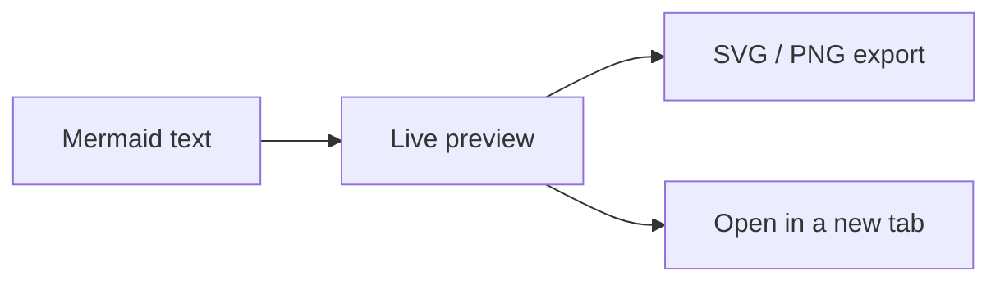
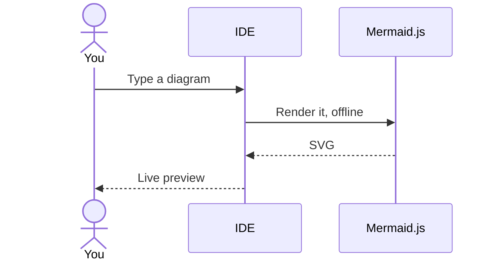

# Welcome to Mermaid Visualizer {{VERSION}}

Thanks for using Mermaid Visualizer! It brings [Mermaid](https://mermaid.js.org/) diagrams to your JetBrains IDE: write diagrams as text, see them rendered live as you type, and export them. Everything runs offline with the bundled Mermaid.js ({{MERMAID_VERSION}}).

## What's new {{WHATS_NEW_SCOPE}}

{{WHATS_NEW}}

Full history: [CHANGELOG.md on GitHub](https://github.com/Alex9583/MermaidVisualizer/blob/master/CHANGELOG.md).

## Support the project

Mermaid Visualizer is free and open source. If it saves you time, you can support my work with **[Buy Me A Coffee](https://buymeacoffee.com/alextdev)**: it helps keep the plugin up to date with every new Mermaid release, and to troubleshoot every issue you bring to my attention. Completely optional, and thank you either way!

Other ways to help, all free:

- **[Star the project on GitHub](https://github.com/Alex9583/MermaidVisualizer)**
- **[Rate the plugin on the JetBrains Marketplace](https://plugins.jetbrains.com/plugin/30432-mermaid-visualizer/reviews)**: a short review helps other developers find it

## Getting started

- **In Markdown:** add a `mermaid` fenced code block to any Markdown file and open the preview, like this page.
- **Standalone files:** open a `.mmd` or `.mermaid` file. It opens in a split editor with a live preview next to the code.
- **Hover a diagram** to show its toolbar: copy or save as SVG/PNG, zoom, fit to window, open in a new tab.

Both diagrams below are rendered live by the plugin:

## What you get

- **Live preview** in the Markdown preview and in the `.mmd`/`.mermaid` split editor, with scroll sync and automatic dark/light theme
- **Zoom, pan, fit to window and 1:1** (Ctrl+wheel to zoom, drag to pan)
- **Open in new tab**: pop any diagram into its own full-size preview tab
- **Export as SVG or PNG**: copy to the clipboard or save to a file
- **Friendly render errors**: the preview keeps the last valid diagram under a banner that explains the error in one line, and the same explanation appears in the `.mmd` editor
- **ELK and dagre layouts**: per diagram with `layout: elk` / `layout: dagre` in the front matter, or globally in the settings
- **Code intelligence** for `.mmd`/`.mermaid` files: syntax highlighting, completion (diagram types, keywords, node names, arrows, directives), inspections and quick-fixes, Structure View, code folding, Go to Definition, Find Usages and Rename

## Settings tour

**Settings > Tools > Mermaid**

- **Theme** (Auto follows the IDE, plus the Mermaid 12 neo and redux themes), **Look** (classic, hand-drawn, neo), **Layout engine** (ELK or dagre), **Font family**
- **Max text size** and **Max edges**: rendering limits, set well above Mermaid's defaults so large generated diagrams render out of the box
- **Live reload delay** and **Error highlight delay**
- **Max preview height**
- **Custom background and line colors**: off by default, so the rendering follows your IDE theme
- **Show the welcome page after plugin updates**: this page

**Settings > Editor > Color Scheme > Mermaid**: syntax highlighting colors.

## Feedback

- Found a bug or have an idea? [Open an issue on GitHub](https://github.com/Alex9583/MermaidVisualizer/issues).
- When a diagram fails to render, the **Report on GitHub** button of the error banner prepares an issue with your plugin, IDE and Mermaid versions. Your diagram is never included.

---

_This page opens once after each update. To turn it off: **Settings > Tools > Mermaid > Show the welcome page after plugin updates**. To reopen it at any time: **Help > Mermaid Visualizer: What's New**._
